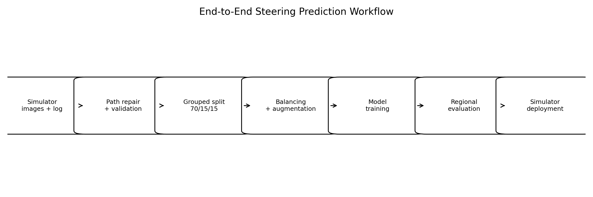
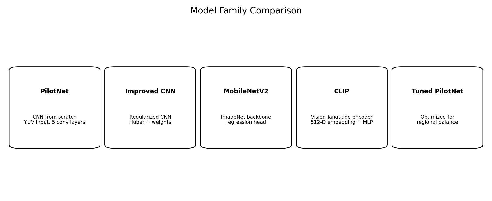
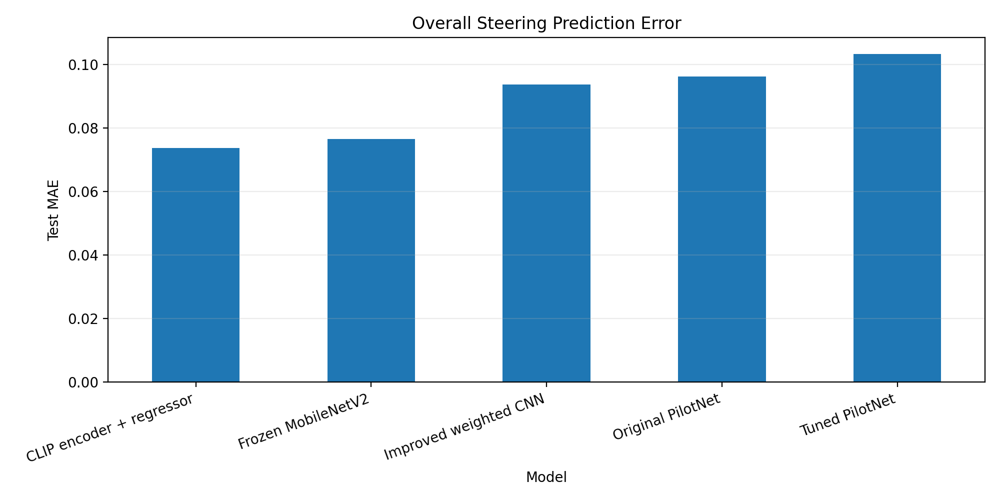
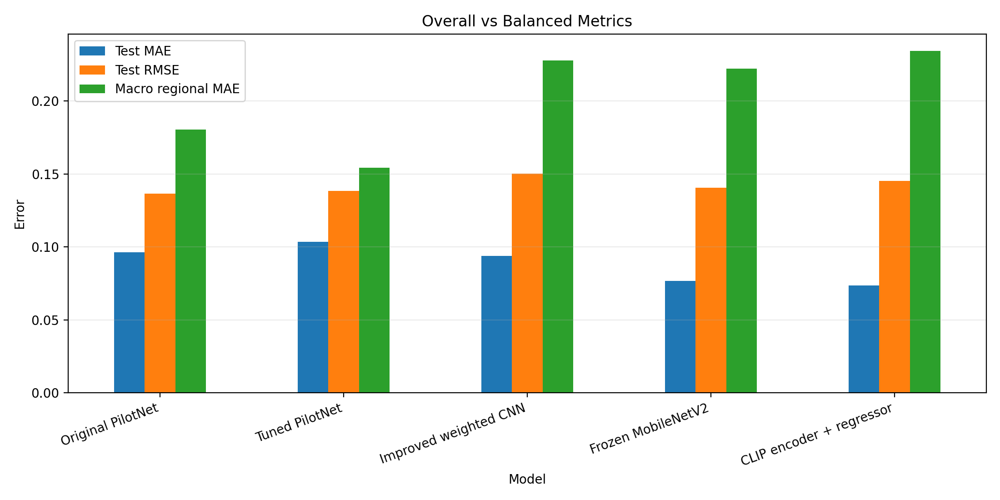
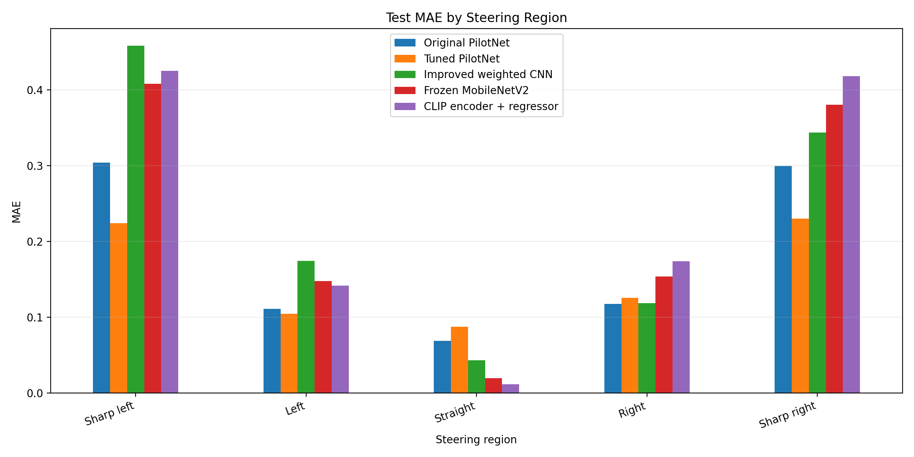

# End-to-End Steering Prediction for Self-Driving Cars

A computer-vision and behavioral-cloning project for predicting steering commands directly from road images generated in the Udacity self-driving car simulator. The repository benchmarks a classical NVIDIA-style CNN baseline against regularized CNN improvements, transfer learning with MobileNetV2, and a CLIP vision-encoder regression pipeline.

The main lesson is that **the model with the lowest overall average error is not always the best driving model**. Since the dataset is dominated by straight-driving frames, this project evaluates both overall error and balanced steering-region error.



## Highlights

- Built a complete image-to-steering regression pipeline.
- Repaired simulator CSV paths and validated 21k+ camera images.
- Reduced data leakage using grouped train/validation/test splitting.
- Applied side-camera steering correction, class balancing, and label-consistent augmentation.
- Implemented and compared five model families.
- Improved overall test MAE from **0.09620** with the baseline CNN to **0.07373** using CLIP visual embeddings.
- Improved balanced steering-region MAE from **0.18040** with the baseline CNN to **0.15440** using a tuned PilotNet.
- Exported trained models to `.h5` and tested them in the simulator through a Socket.IO driving client.

## Problem formulation

The task is supervised regression:

```text
front camera image → steering angle
```

The steering angle is continuous, with negative values indicating left turns, values near zero indicating straight driving, and positive values indicating right turns.

## Dataset summary

| Item | Value |
|---|---:|
| Driving records | 7,107 |
| Image files | 21,325 |
| Cameras | Center, left, right |
| Original image shape | 160 × 320 × 3 |
| Split | 70% train, 15% validation, 15% test |
| Balanced training samples | 5,260 |

The original dataset was heavily biased toward straight driving: approximately 75% of records had steering magnitude below 0.05. To avoid misleading model selection, the evaluation includes both dataset-weighted metrics and region-balanced metrics.

## Model versions



| Model | Reason for inclusion |
|---|---|
| Original PilotNet | Classical end-to-end CNN baseline trained from scratch |
| Improved weighted CNN | Tests regularization, Huber loss, steering weights, and parameter reduction |
| Frozen MobileNetV2 | Tests transfer learning from a lightweight ImageNet-pretrained backbone |
| CLIP encoder + regressor | Tests vision-language-pretrained image embeddings for steering regression |
| Tuned PilotNet | Optimizes the baseline CNN for balanced steering-region performance |

## Results

### Overall error



| Model | Test MAE | Test RMSE | Test R² | Macro regional MAE |
|---|---:|---:|---:|---:|
| Original PilotNet | 0.09620 | **0.13646** | **0.14369** | 0.18040 |
| Tuned PilotNet | 0.10340 | 0.13850 | 0.11782 | **0.15440** |
| Improved weighted CNN | 0.09376 | 0.15034 | -0.03945 | 0.22774 |
| Frozen MobileNetV2 | 0.07657 | 0.14048 | 0.09251 | 0.22222 |
| CLIP encoder + regressor | **0.07373** | 0.14526 | 0.02968 | 0.23419 |

### Overall vs balanced performance



CLIP achieved the best overall MAE because it predicted the dominant straight-driving cases extremely well. However, tuned PilotNet achieved the best macro regional MAE because it improved rare but important sharp-turn performance.

### Region-wise MAE



The regional comparison reveals why average error alone is not sufficient. Models based on pretrained visual encoders performed very well on straight driving but underpredicted sharp steering angles. Tuned PilotNet was more balanced across steering regions.

## Repository structure

```text
.
├── assets/
│   ├── figures/             # README figures generated from experiment results
│   └── screenshots/          # Optional simulator or notebook screenshots
├── configs/                  # Configuration templates
├── data/                     # Dataset placeholder; raw data is not tracked
├── docs/                     # Design notes, experiment notes, deployment guide
├── models/                   # Model placeholder; large model files are not tracked
├── notebooks/                # Sanitized experiment notebook
├── results/                  # CSV summaries used by the README
├── scripts/                  # Runnable training/evaluation entry points
├── src/                      # Reusable Python modules
├── README.md
├── requirements.txt
├── requirements-simulator.txt
└── .gitignore
```

## Setup

Create a Python environment:

```bash
python -m venv .venv
source .venv/bin/activate  # Linux/macOS
# .venv\Scripts\activate   # Windows PowerShell
pip install -r requirements.txt
```

For simulator deployment with the older Udacity simulator protocol, install:

```bash
pip install -r requirements-simulator.txt
```

## Data layout

Place the simulator dataset in a local directory such as:

```text
data/raw/
├── driving_log.csv
└── IMG/
    ├── center_*.jpg
    ├── left_*.jpg
    └── right_*.jpg
```

The repository does not track the raw dataset or trained `.h5` files. This keeps the repository lightweight and avoids committing large binary artifacts.

## Example usage

Train a PilotNet-style baseline:

```bash
python scripts/train_pilotnet.py --data-dir data/raw --output-dir models
```

Evaluate a saved model:

```bash
python scripts/evaluate_model.py --model models/pilotnet_tuned_low_dropout.h5 --model-type pilotnet --data-dir data/raw
```

Run the simulator client:

```bash
python src/drive_simulator.py --model models/pilotnet_tuned_low_dropout.h5 --model-type pilotnet --speed-limit 6
```

## Key technical choices

- **Grouped splitting:** sequential frames were grouped before splitting to reduce train/validation leakage.
- **Side-camera correction:** left and right camera views were assigned corrected steering values to improve recovery behavior.
- **Training-only balancing:** overrepresented near-zero steering samples were reduced only in the training set.
- **Label-consistent augmentation:** image translation and flipping also changed the steering label.
- **Regional evaluation:** steering values were divided into sharp-left, left, straight, right, and sharp-right regions.
- **Macro regional MAE:** each steering region contributed equally to balanced model selection.

## Deployment notes

The simulator client supports these model types:

| Model type flag | Expected input | Preprocessing |
|---|---|---|
| `pilotnet` | 66 × 200 × 3 | Crop, resize, RGB→YUV, normalize to [-1, 1] |
| `improved` | 66 × 200 × 3 | Same as PilotNet |
| `mobilenet` | 96 × 160 × 3 | Crop, resize, MobileNetV2 preprocessing |

The CLIP regression head is not directly deployable from raw simulator images by itself because it expects a 512-dimensional CLIP embedding.

## Limitations

- The dataset is synthetic and track-specific.
- Offline frame-level MAE does not fully predict closed-loop simulator behavior.
- The models are single-frame predictors and do not use temporal memory.
- The throttle controller is separate and very simple.
- CLIP was used as a frozen visual encoder, not as a full vision-language-action model.

## Future work

- Collect more recovery-driving and sharp-turn data.
- Add temporal models such as CNN-LSTM or video transformers.
- Jointly predict steering and throttle.
- Add uncertainty estimation and steering smoothing.
- Benchmark lap completion, intervention count, and off-track events.
- Test generalization on additional tracks and lighting conditions.

## Conclusion

Pretrained visual encoders improved dataset-weighted average accuracy, with CLIP reaching the lowest test MAE. However, tuned PilotNet produced the most balanced steering behavior across straight driving and sharp turns. For autonomous steering, this project shows that model selection should consider rare but safety-critical cornering cases, not only overall MAE.
